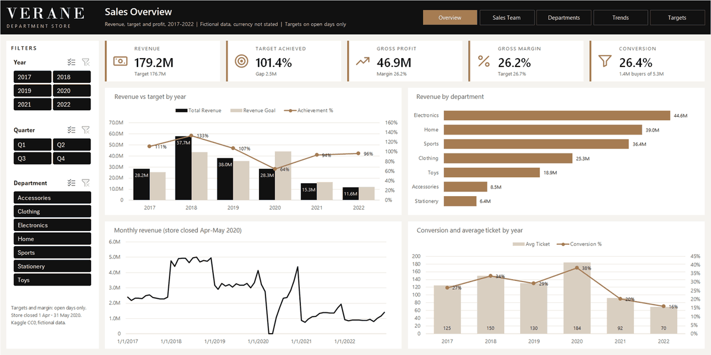
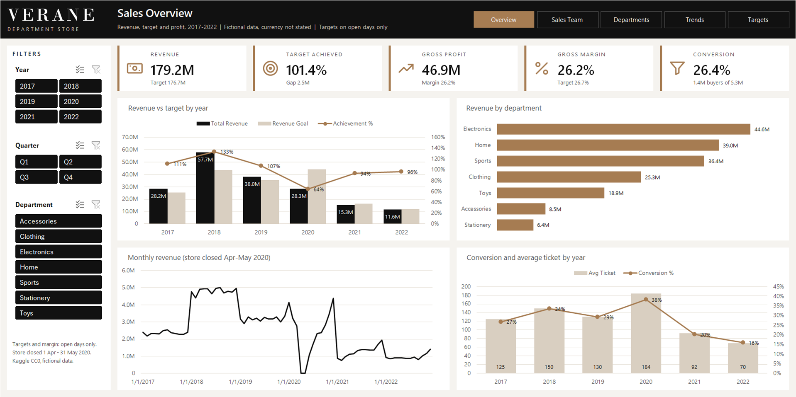
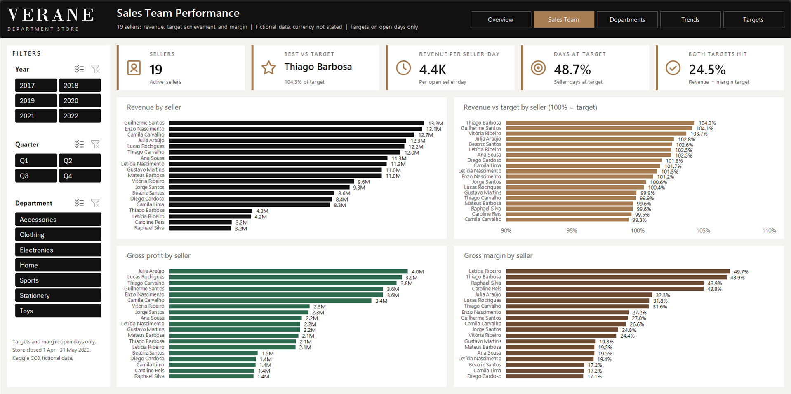
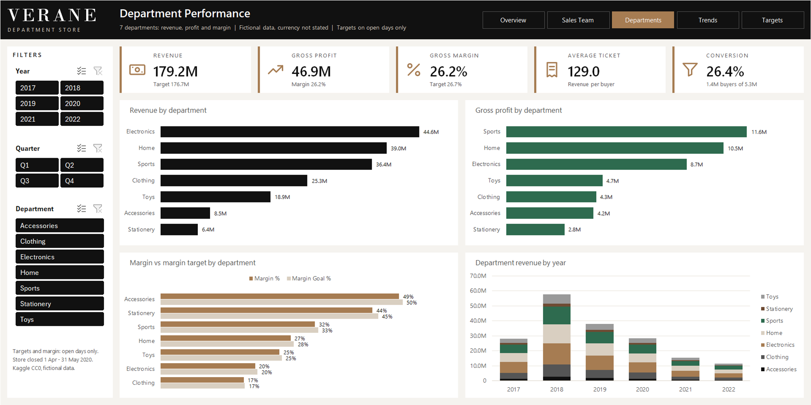
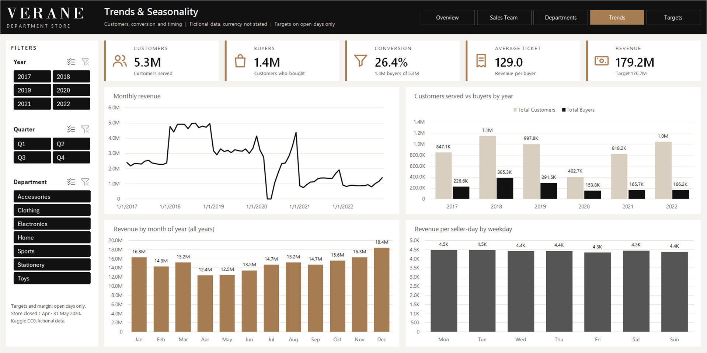
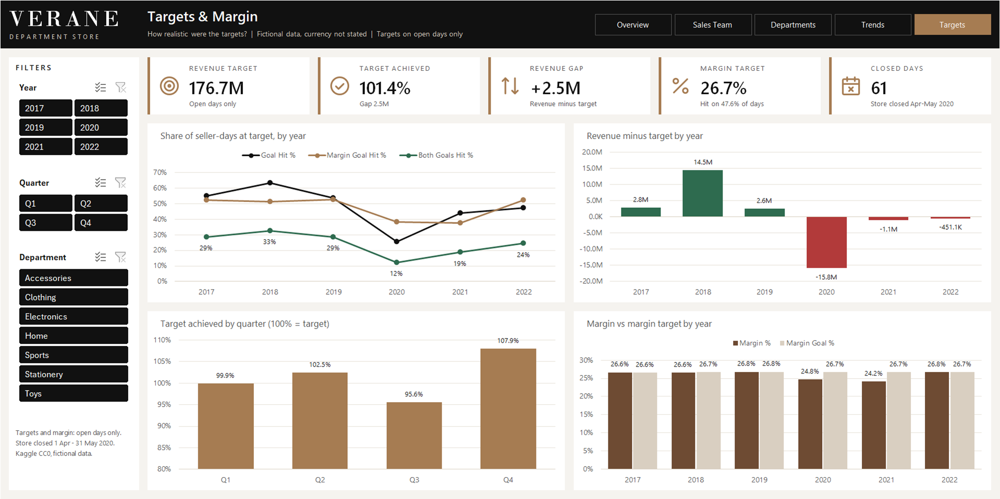

# Department Store Sales & Seller Performance Dashboard - Excel

Excel dashboard on 6 years of daily sales by 19 salespeople in a department store (41,629 rows, 2017-2022).
Built for a fictional brand, VERANE.

Tools: Power Query, Power Pivot (DAX), Pivot Tables, Pivot Charts, Slicers.

## About the project

The questions a sales manager would ask: are we hitting target, who is selling well, which departments make the money, and why are sales going down?

I cleaned the data in Power Query, loaded it into the Data Model, wrote 20 measures in DAX and built the report from pivot tables. The 3 slicers (Year, Quarter, Department) are connected to all the pivots, so every page filters together.

The Objectives sheet has the 25 questions I worked on and the answer to each one. The Cleaning_Log sheet lists every cleaning step.

## Main findings

- 179.2M revenue and 46.9M gross profit (26.2% margin). The store reached 101.4% of its revenue target
- Revenue peaked at 57.7M in 2018 and dropped to 11.6M in 2022 (-80%)
- The drop is not about traffic. Apart from 2020 the store still served 0.8-1.1M customers a year, but conversion went from 33.5% (2018) to 16.0% (2022) and the average ticket from 150 to 70
- Electronics brings the most revenue (24.9%) but only a 19.5% margin. Sports makes the most gross profit (11.6M). Accessories has the best margin (49.3%) but is the second smallest department
- All 19 sellers are between 99.3% and 104.3% of target. Thiago Barbosa is the best, 6 sellers are just under 100%
- Every seller hits the daily target on only 47-50% of days, and hits revenue and margin targets on the same day only 24.5% of the time
- Q4 is the strongest quarter (107.9% of target), Q3 the weakest (95.6%). December is the best month. The day of the week makes almost no difference

## Data issues

- The store was closed from 1 April to 31 May 2020 (61 days, 1,159 rows with zero customers and zero sales). The targets for those days were still in the data, which made the store look like it missed target (96.5%). I kept the rows, flagged them, and removed the targets and margins for closed days, so target achievement is measured on open days only (101.4%)
- Even without the closed days, the 2020 target was 44.1M against 28.3M of revenue (64%). The targets were not adjusted after the closure
- Department names were in Portuguese, I translated them to English
- No currency is given in the data, so amounts have no currency sign

## Pages

1. Overview
2. Sales Team (revenue, target achievement, profit and margin by seller)
3. Departments (revenue, profit, margin vs target, revenue by year)
4. Trends (monthly revenue, customers vs buyers, month of year, weekday)
5. Targets (days at target, revenue gap by year, quarter, margin vs target)

## Files

- `dashboard/VERANE_Sales_Dashboard.xlsx` - the workbook (pivot, KPI and check sheets are hidden, right-click a tab > Unhide to see them)
- `data/department_store_dataset.zip` - original data from Kaggle
- `data/Sales_Clean.zip` - cleaned data from Power Query
- `power-query/` - the M code of both queries
- `dax/measures.dax` - the DAX measures
- `images/` - screenshots and the GIF

## Data source

[Department Store Sales Dataset](https://www.kaggle.com/datasets/raphaelpuziol/department-store-sales-dataset) by Raphael Puziol on Kaggle (CC0). The data is fictional and not related to any real company. VERANE is a brand name I made up for this project.
